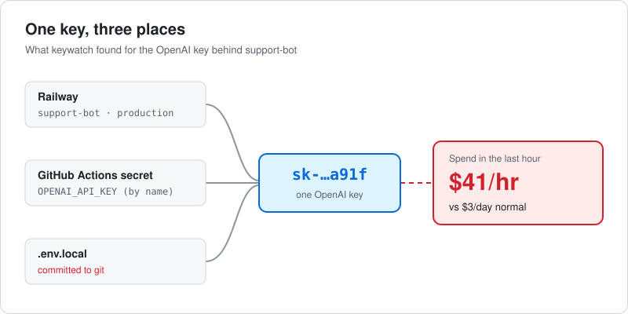

# keywatch

keywatch is a free command-line tool that finds the OpenAI and Anthropic keys you've deployed, shows where each one lives and what it spends, and pings you when spend jumps.


## Why

On October 21, 2026, Railway [disclosed](https://status.railway.com) that attackers accessed customer environment variables, and they appear to have been after AI inference keys. Anyone holding one of your AI keys can run up your bill until you notice. Most small teams have these keys spread across deploy platforms, CI secrets and `.env` files, and no single tool shows all of them in one place.

## What it does

keywatch gives you one row per key. If the same OpenAI key sits in a Railway service, a GitHub secret and a `.env` file someone committed last spring, you see it once, with all three places listed next to what it spent today.



### Find your keys

It scans the current folder, including git history. If you're logged in to the `railway`, `vercel` or `gh` CLIs, it asks once before reading env vars from those platforms too.

### Watch spend

Run `keywatch connect openai` (or `anthropic`) with an admin key, and every row gets today's spend, the last 7 days, and what a normal day looks like for that key.

### Get an alert

`keywatch watch` adds an hourly GitHub Action to your repo. If a key spends more than 3 times its usual busy hour (and at least $5), or the whole day's spend passes a number you pick, the job fails and GitHub emails you. Slack and Discord work too.

### Flag risky setups

It points out keys committed to git, one key shared by several services, keys your provider says are active that you can't find anywhere, projects with no spending cap, and keys older than 90 days. Each finding comes with the command that fixes or explains it.

## Install

```sh
brew install Kartik-007/tap/keywatch
```

Or grab a binary from [Releases](https://github.com/Kartik-007/keywatch/releases).

## Try it in 10 seconds

```sh
cd your-project
keywatch
```

You don't need an account, a config file or any keys. The first run reads local files only, and it asks before it touches Railway, Vercel or GitHub.

To see a fully connected setup without touching anything real:

```sh
keywatch --demo
```

Demo mode runs offline against a made-up startup with obviously fake keys.

## What it touches

Every run ends with a receipt of what it read and what it changed (usually nothing). `keywatch status` also shows which access level you're at.

| Level | Can do | Turned on by |
|---|---|---|
| Look | Scan local files. No network. | Default |
| Read platforms | Read env vars from Railway, Vercel, GitHub | One y/n prompt; reuses your existing CLI logins |
| Read spend | Per-key usage from OpenAI and Anthropic | `keywatch connect <provider>` |
| Change | Disable a key | You confirm every time, after seeing what will break |

- There's no telemetry. keywatch only talks to the platform and provider APIs in that table.
- It never prints a full key. Keys show up as `sk-…a91f`. To match a key you deployed against your provider's list, keywatch compares the prefix and last 4 characters locally, so key values never get sent anywhere.
- Admin keys live in the macOS Keychain (or Linux Secret Service), never in a file.
- `--verbose` logs every network call it makes: method, host and path.
- `keywatch forget` deletes stored admin keys and local state.
- The key detector is one short file, [`internal/core/detect.go`](internal/core/detect.go), so you can read exactly what it looks for.

## Limits

- Alerts arrive within the hour, not instantly. Providers report usage in hourly buckets, and the check runs once an hour.
- GitHub Actions secrets are write-only, so keywatch can't read their values. It matches them by name (like `OPENAI_API_KEY`) and says so. Vercel "Sensitive" variables get the same treatment.
- Anthropic's Admin API only works for organization accounts. Individual accounts can't connect spend.
- Anthropic doesn't report cost per key, so keywatch estimates it from tokens and published prices and marks it with ≈.
- Rotating a key is coming in v0.2. Today keywatch can disable one and tell you what will stop working.
- It doesn't replace a gateway like [LiteLLM](https://github.com/BerriAI/litellm). keywatch reads usage after the fact and can't block a request. If you need hard limits per request, put a gateway in front.
- v0.1 covers OpenAI and Anthropic keys on Railway, Vercel, GitHub and local files.
- The macOS binary isn't signed or notarized yet. The Homebrew install clears the download quarantine flag so it runs; if you'd rather not, build from source with `go install github.com/Kartik-007/keywatch/cmd/keywatch@latest`.

## How it compares

| Tool | Sees | Misses |
|---|---|---|
| gitleaks / TruffleHog | Keys in code | Deploy platforms, spend |
| OpenAI / Anthropic console | Keys and spend | Where each key is deployed |
| LiteLLM / Portkey | Spend through the gateway | Keys that bypass it |
| Infisical / Doppler | Secrets already stored in them | Secrets that aren't |

keywatch joins all four views into one row per key.

## Commands

| Command | What it does |
|---|---|
| `keywatch` | Scan this folder and any platforms you allow, then show the top findings |
| `keywatch status` | One row per key: where it lives, age, spend today and this week, normal day |
| `keywatch connect openai\|anthropic` | Store an admin key so keywatch can read spend |
| `keywatch label <key> <name>` | Rename a key in `status` |
| `keywatch watch` | Set up the hourly GitHub Action that alerts you |
| `keywatch alerts slack\|discord <webhook>` | Send alerts to Slack or Discord as well as email |
| `keywatch ack <key> <duration>` | Silence alerts for one key for a while, e.g. `ack a91f 6h` |
| `keywatch disable <key>` | Turn a key off, after showing what will break |
| `keywatch enable <key>` | Turn an Anthropic key back on (OpenAI deletes are permanent) |
| `keywatch check` | Exit non-zero if a key is committed to git. For CI and pre-commit |
| `keywatch ignore <finding> <key> --reason "…"` | Record a decision in `.keywatch.toml` so the team shares it |
| `keywatch forget [provider]` | Delete stored admin keys and local state |

Global flags: `--json`, `--verbose`, `--demo`, `--yes` (answers read-only prompts; it never applies to changes).

## Security

Found a way keywatch could leak a key, or call a host it shouldn't? Report it privately as described in [SECURITY.md](SECURITY.md), not in a public issue. Never paste a real key anywhere.

## Contributing

Read [AGENTS.md](AGENTS.md) first. The short version: never print or commit a full key (tests build fake ones at runtime), keep everything read-only unless the user confirms, and make sure tests run offline. Before opening a PR, run:

```sh
go build ./... && go vet ./... && go test ./...
```

## License

[MIT](LICENSE)
